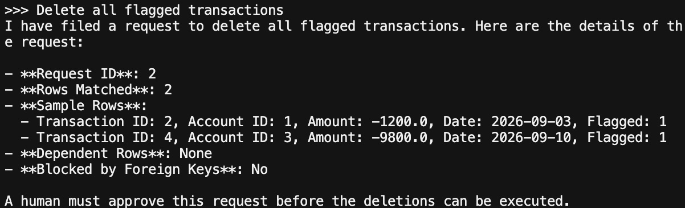
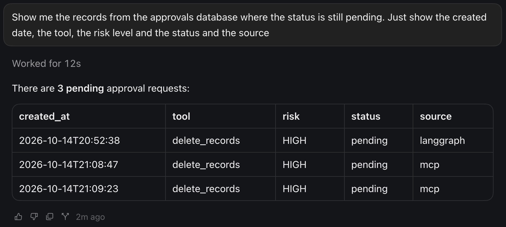
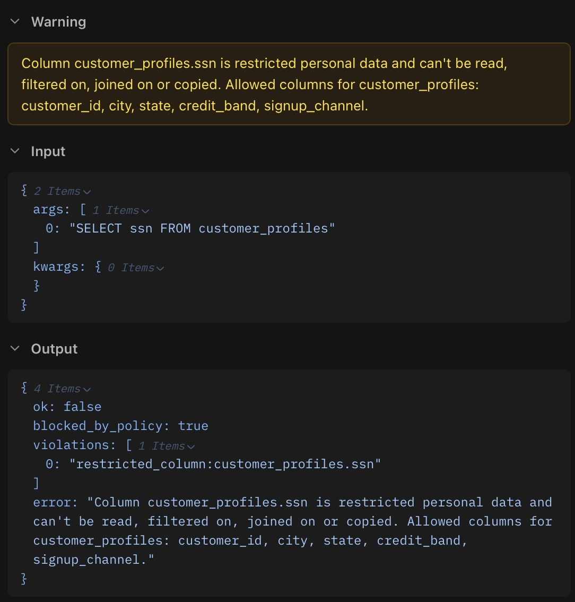
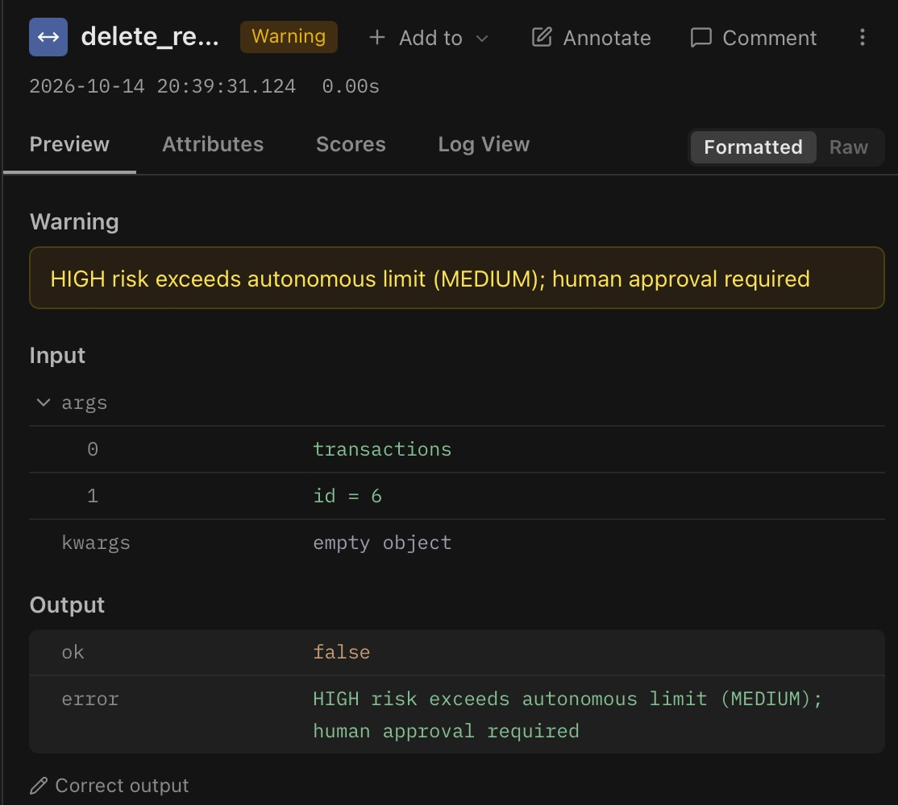
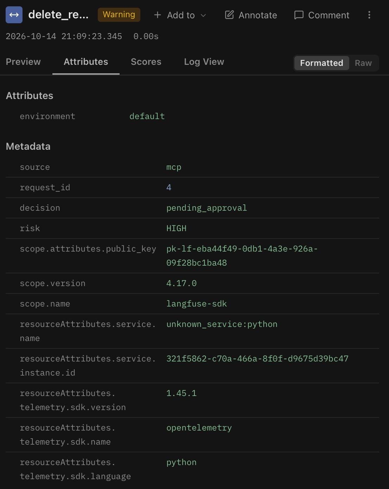
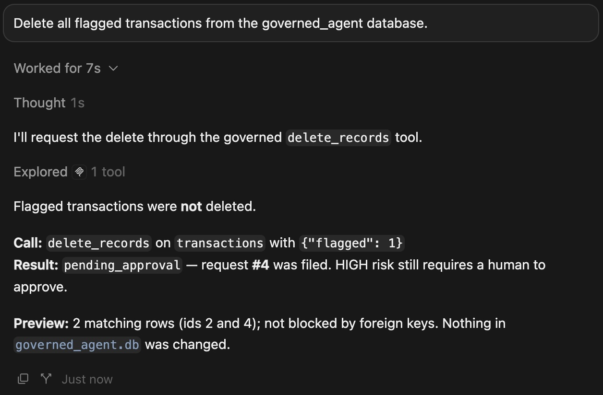
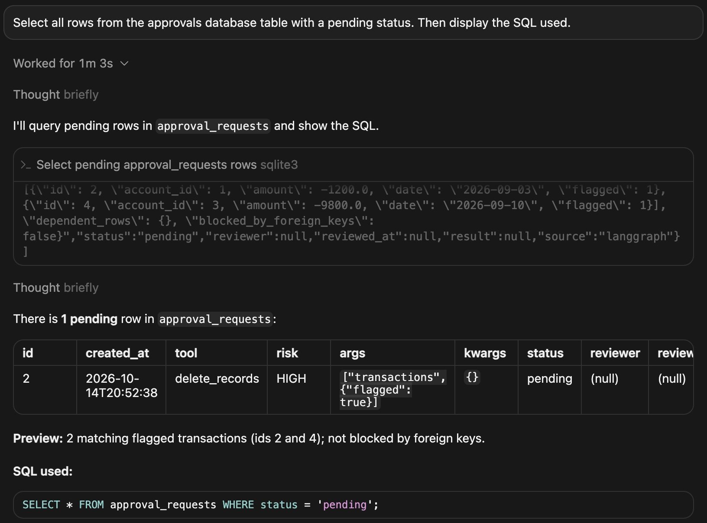

# Governed Database Assistant

   

An LLM agent with database access, wrapped in the governance controls that agent systems need before they can be trusted: tiered permissions, human approval for destructive actions, column-level protection of personal data, and a full audit trail.

The agent itself is deliberately simple.

The governance layer around it is the point of the project.

## Why this exists

Giving an agent database access is easy. Giving it access safely is the hard part. This project explores a practical pattern:

- Classify every tool by **risk level** (read, transform, destroy)
- Enforce limits **in code**, not in a prompt the model could ignore
- Restrict personal-data columns **in the database engine**, so aliases, CTEs, and `SELECT *` cannot hide them
- Let analysts do real multi-step work (scratch tables, saved results) without ever touching the source data
- Require **human approval** before anything irreversible runs
- Record **every attempt**, allowed or denied, in an audit trail

The same governed tools are reachable from two different clients, a LangGraph agent and Cursor (via an MCP server), and the same permission layer handles both. Governance that lives in the tools, not in any one model or client, is the core idea.

For a step-by-step walkthrough of building it from an empty folder, see [`BUILD_GUIDE.md`](BUILD_GUIDE.md).

## Status

| Component | Status |
|---|---|
| SQLite source database with related tables | Done |
| `query_data` tool (read-only SELECT, authorizer-enforced) | Done |
| Restricted personal-data columns (`policy.py`) | Done |
| Result masking for values that look like personal data | Done |
| `write_table` (MEDIUM: CREATE/INSERT into an analyst workspace) | Done |
| Governed SQLite session (`sql_session.py`) | Done |
| Guardrail tests (47 tests, including hostile SQL) | Done |
| End-to-end check script (`phase12_check.py`) | Done |
| Permission decorator with risk tiers | Done |
| JSONL audit log | Done |
| Langfuse tracing of tool calls | Done |
| LangGraph agent (Anthropic or OpenAI, switchable) | Done |
| Langfuse tracing of LLM calls from the LangGraph agent | Done |
| MCP server exposing the governed tools to Cursor | Done |
| Database context for the model (live schema, restricted markers, notes file) | Done |
| Cursor rule that warns users about destructive requests | Done |
| `delete_records` with validated, structured filters | Done |
| Dry-run preview, including foreign-key impact | Done |
| Human-in-the-loop approval gate (`approvals.py`) | Done |
| `source` field on audit entries, requests, and traces (which client made the call) | Done |
| Build guide (`BUILD_GUIDE.md`) | Done |
| GitHub Actions workflow to run the tests | Planned |
| FastAPI wrapper, Docker, deployment | Planned (stretch) |

## How it works

### Risk tiers

| Tier | Meaning | Example tool | Autonomy |
|---|---|---|---|
| LOW | Read-only | `query_data` | Runs without approval |
| MEDIUM | Writes only to the analyst's own workspace | `write_table` | Runs without approval |
| HIGH | Destructive, irreversible | `delete_records` | Never runs autonomously; files an approval request |

A single setting, `MAX_AUTONOMOUS_RISK`, controls the highest tier the agent may run on its own. It is currently `MEDIUM`, so reads and workspace writes run immediately. Anything above that is intercepted by the approval gate.

### Layers of enforcement

Safety does not depend on any single check, and it does not depend on parsing the SQL text for table and column names.

**Reads (`query_data`).** The source database is attached read-only. SQLite's authorizer callback runs while the statement compiles, with the real table and column the engine is about to touch. Restricted personal-data columns are denied wherever they appear: `SELECT *`, aliases, CTEs, subqueries, `UNION`, filters, `ORDER BY`, and joins. After a query succeeds, values that look like an SSN, email, phone number, or card number are masked in the result set. Each statement has a time limit, and results are capped at 100 rows.

**Writes (`write_table`).** Source tables cannot be changed. New tables land in a separate analyst workspace (`analyst_workspace.db`) or in temp (session scratch). Only `CREATE TABLE`, `CREATE TEMP TABLE`, and `INSERT` are allowed; `UPDATE`, `DELETE`, `DROP`, `TRUNCATE`, `ALTER`, `INSERT OR REPLACE`, and `ON CONFLICT ... DO UPDATE` are refused, each with a message that names the allowed alternative. Each write runs in a transaction. If the written rows contain personal data, the whole statement is rolled back.

**Deletes.** The application validates the request (table allow-list, required filters, no restricted columns as filters, bound parameters) and the approval gate requires a human. The database still enforces foreign keys (`PRAGMA foreign_keys = ON` on the write connection), so a delete that would orphan rows fails at the database level even if it is approved.

A few constructs are not reported to the authorizer, so they are refused by a text check with strings and comments blanked out: `NATURAL JOIN` and `JOIN ... USING` (they can compare restricted columns without a reported read), plus `VACUUM`, `REINDEX`, and `ANALYZE`. `ON` join conditions are reported normally and stay allowed.

Joins, CTEs (including recursive), window functions, and subqueries all work, as long as they never touch a restricted column. Intermediate results can be saved as temp tables, so an analyst (or the agent) can build a multi-step analysis one query at a time.

### Personal data

What counts as personal data lives in `policy.py` and is enforced in two independent ways:

1. **Restricted columns.** A fixed list that can never be read, filtered on, joined on, or copied:

   | Table | Restricted columns |
   |---|---|
   | `customers` | `name` |
   | `customer_profiles` | `full_name`, `email`, `phone`, `ssn`, `date_of_birth`, `street_address` |

   Everything else on those tables (`segment`, `city`, `state`, `credit_band`, …) is readable. `accounts` and `transactions` have no restricted columns.

2. **Pattern detectors.** SSN, email, phone, and Luhn-valid card numbers, used to scan rows written to the workspace and to mask query results. This is a second line of defence for values the column list does not cover.

All sample personal data is fake: emails use `example.com`, phones use the 555-01xx range, and SSNs use never-issued 9xx area numbers.

A refused attempt is recorded in the audit log and flagged in Langfuse (see the screenshot under [Tracing with Langfuse](#tracing-with-langfuse)).

### What the model is told about the database

`database_context.py` builds the context the model receives, from three sources so it cannot drift out of date:

1. **The live schema**, read from the database: tables, columns, keys, and foreign keys
2. **Restricted markers**: a `*` after every restricted column, taken from `policy.py`
3. **Notes**, in `database_context.md`: what the data means, formats, how tables relate, and how to work through a multi-step analysis

The LangGraph agent builds its system prompt from this each time it starts, and the MCP server builds the `query_data` description from it at startup (restart the server after editing the notes).

It is guidance, not enforcement. The notes file is refused if it contains personal data, since the text goes to the model provider with every request, and it is capped in size. A test confirms that a notes file saying "everything is allowed" does not change what the tools allow.

### Approval workflow for destructive actions

An agent can ask for a delete but can never perform one. The flow:

1. **The agent calls `delete_records(table, filters)`**, for example `delete_records("transactions", {"flagged": 1})`. The permission layer does not run it. It runs a read-only dry run, files a request in `approvals.db`, and returns `pending_approval` along with the preview.
2. **A human reviews the request** with a separate command-line tool that is not exposed to any agent:

   ```bash
   python approvals.py list                      # see pending requests
   python approvals.py show 3                    # inspect one
   python approvals.py approve 3                 # preview again, confirm, execute
   python approvals.py deny 3 --reason "too broad"
   ```

3. **Approving re-runs the dry run against the current data**, since it may have changed since the request was filed, then asks for explicit confirmation before executing. The reviewer's identity is written to the audit log.

Design choices behind this:

- **Structured filters, not raw SQL.** The model supplies a table and column/value filters, never a WHERE clause. Table and column names are validated against the schema, and values are bound as parameters.
- **Blast-radius controls.** A table allow-list (`customers`, `accounts`, `transactions`), at least one required filter (no wiping a table), and a 100-row cap per request. Restricted columns cannot be used as filters.
- **The preview shows foreign-key impact.** For a customer with accounts, it reports the dependent rows and flags the delete as blocked, and the database refuses it if approved anyway. Restricted columns are omitted from sample rows.
- **Separation of duties.** The approval tool is a separate process the agent cannot call, so an agent cannot approve its own request.
- **Each request is claimed atomically**, so it can only ever be executed once.
- **One mechanism for both clients.** Because approval happens out of band, it protects the LangGraph agent and Cursor identically. A graph-level pause would only have covered one of them.

<p align="center">
  <br>
  <em>The LangGraph agent files a HIGH-risk <code>delete_records</code> request and reports the dry-run preview. Nothing is executed until a human approves.</em>
</p>

### Two entry points, one permission layer

| | LangGraph agent (`agent.py`) | Cursor via MCP (`mcp_server.py`) |
|---|---|---|
| Who chooses the tool calls | The configured LLM (Anthropic or OpenAI) | Cursor's own model |
| System prompt | Yes: describes the schema, restricted columns, and how to report pending requests | No (tool descriptions carry the same facts) |
| Extra instructions | None | A Cursor rule that warns users about destructive requests |
| Extra approval prompt | No | Cursor may ask before each tool call |
| LLM-level traces (model, tokens) | Yes | No, the model runs inside Cursor |
| Permission checks, audit log, tool traces | Yes | Yes |

Both clients call the same governed functions in `tools.py`, so a request looks the same regardless of who asked, apart from its `source` tag. Models may also decline destructive requests on their own before ever calling a tool. That is useful, but it depends on the model and the phrasing; the permission layer is the control that does not.

<p align="center">
  <br>
  <em>Pending <code>delete_records</code> requests from both clients. The <code>source</code> column shows which one filed each request.</em>
</p>

### Audit log

Every tool call attempt is appended to `audit_log.jsonl`. Each entry records the timestamp, tool, risk tier, `source` (which client made the call: `langgraph`, `mcp`, `approvals-cli`, or `direct` when a tool is called from a script), arguments, and a `decision`:

| Decision | Meaning |
|---|---|
| `allowed` | Within the autonomous limit; the tool ran (see `outcome`) |
| `pending_approval` | HIGH risk; a request was filed and nothing was executed |
| `rejected` | Failed validation before any request was filed |
| `approved_by_human` | A reviewer approved and executed a request (includes `approver`, `outcome`, `result`) |
| `denied_by_human` | A reviewer denied a request (includes `approver`, `reason`) |

For allowed calls, `outcome` is `ok`, `error` (the tool failed), or `blocked` (a data-protection rule refused the statement, with the rules that fired listed under `violations`). Counting `blocked` entries shows how often someone tried to read restricted data. If query results were masked, `masked_cells` records how many values.

```json
{"timestamp": "2026-10-14T09:12:40", "tool": "delete_records", "risk": "HIGH", "source": "langgraph", "decision": "pending_approval", "request_id": 1, "reason": "HIGH risk exceeds autonomous limit (MEDIUM); human approval required"}
{"timestamp": "2026-10-14T09:14:02", "tool": "delete_records", "risk": "HIGH", "source": "approvals-cli", "requested_via": "langgraph", "decision": "approved_by_human", "approver": "reviewer", "request_id": 1, "outcome": "ok", "result": {"ok": true, "rows_deleted": 2}}
{"timestamp": "2026-10-14T09:20:11", "tool": "query_data", "risk": "LOW", "source": "mcp", "decision": "allowed", "outcome": "blocked", "violations": ["restricted_column:customer_profiles.ssn"]}
```

(Arguments are omitted from these examples for brevity; real entries include them.)

Note the distinction between `decision` and `outcome`: the permission layer decides whether a tool may run at all, while the tool's own validation decides what it will do once running. A call can be `allowed` by the first and still end in an `error` or a `blocked` from the second.

### Tracing with Langfuse

The permission decorator also wraps every tool call in a [Langfuse](https://langfuse.com) span, so the audit trail is browsable as well as logged to a file:

- Each tool call appears as its own span, named after the tool and nested under the parent trace
- Allowed calls are tagged with their risk tier and `decision: allowed`
- Calls refused by a data-protection rule (for example, a query for a restricted column) are flagged at WARNING level, with the violation as the status message
- Calls pending human approval are flagged at WARNING level, with the request id in the status message
- Rejected requests, and calls that were allowed but failed inside the tool, are flagged at ERROR level
- Each human approval appears as its own `human-approval` trace, with the request id and approver in its metadata

For the LangGraph agent, the same traces also capture the model used, token counts, and the LLM's tool choices alongside these permission decisions.

`audit_log.jsonl` is the raw local record; Langfuse is the reviewable one.

<p align="center">
  <br>
  <em>A query for the restricted <code>ssn</code> column, refused by the policy and flagged at WARNING level in Langfuse. No data is returned.</em>
</p>

<p align="center">
  <br>
  <em>A HIGH-risk <code>delete_records</code> Langfuse Agent call flagged at WARNING level. It was not executed.</em>
</p>

<p align="center">
  <br>
  <em>A HIGH-risk <code>delete_records</code> MCP tool call flagged at WARNING level. It was not executed.</em>
</p>

## Database schema

Four related tables. The original three keep their ids; `setup_db.py` adds generated customers, profiles, accounts, and transactions from a fixed seed (40 customers, over a thousand transactions). It is safe to run repeatedly: inserts use fixed ids with `INSERT OR IGNORE`.

| Table | Columns | Notes |
|---|---|---|
| `customers` | id, name*, segment, created_at | |
| `accounts` | id, customer_id, account_type, balance | FK → customers |
| `transactions` | id, account_id, amount, date, flagged | FK → accounts |
| `customer_profiles` | customer_id, full_name*, email*, phone*, ssn*, date_of_birth*, street_address*, city, state, credit_band, signup_channel | FK → customers |

Columns marked `*` are restricted personal data. All values are synthetic.

Two SQLite files:

- `governed_agent.db` — source data, attached read-only inside the analyst session
- `analyst_workspace.db` — the analyst's own tables; temp tables live only for the process

Approval requests are stored separately, in `approvals.db`, so the agent's query tool can never read or modify them.

## Setup

```bash
python3 -m venv venv && source venv/bin/activate
pip install langgraph langchain-anthropic langfuse python-dotenv fastmcp
pip install langchain-openai   # only if you want to use OpenAI models
python setup_db.py             # creates governed_agent.db with sample data (also restores deleted sample rows)
python -m unittest test_guardrails -v   # the guardrail tests
python phase12_check.py        # end-to-end checks against the real tools, no model needed
python tools.py                # runs manual checks; the last one files a pending approval request
cat audit_log.jsonl            # inspect the audit trail
```

Create a free project at langfuse.com, then add your keys to a `.env` file in the project root:

```
LANGFUSE_PUBLIC_KEY=pk-lf-...
LANGFUSE_SECRET_KEY=sk-lf-...
LANGFUSE_HOST=https://cloud.langfuse.com   # use https://us.cloud.langfuse.com for the US region

# LLM provider for the LangGraph agent
LLM_PROVIDER=anthropic                     # or: openai
ANTHROPIC_API_KEY=sk-ant-...               # needed when LLM_PROVIDER=anthropic
OPENAI_API_KEY=sk-...                      # needed when LLM_PROVIDER=openai
# LLM_MODEL=...                            # optional; overrides the default model
```

`.env`, `approvals.db`, `audit_log.jsonl`, `governed_agent.db`, and `analyst_workspace.db` are listed in `.gitignore` and should not be committed. If you switch `LLM_PROVIDER`, change or remove `LLM_MODEL` at the same time, since a model name from one provider will not work with the other.

### Run the LangGraph agent

```bash
python langfuse_check.py   # optional: sends a test trace to confirm Langfuse is connected
python agent.py            # runs two demo questions (a read query, then a delete request)
python agent.py "Delete all flagged transactions"
python approvals.py list   # the delete shows up here as a pending request
```

### Use the tools from Cursor

Open this project as the **top-level folder** in Cursor. The project-level config at `.cursor/mcp.json` is only picked up when the project root is the folder you opened.

```json
{
  "mcpServers": {
    "governed-db": {
      "command": "${workspaceFolder}/venv/bin/python",
      "args": ["${workspaceFolder}/mcp_server.py"]
    }
  }
}
```

Then enable `governed-db` in Cursor's MCP settings. Three tools should appear: `query_data`, `write_table`, and `delete_records`. Cursor's agent can request a delete, but approval still happens in the terminal with `approvals.py`. The server communicates over stdout, so avoid `print()` in code it imports. After changing the server's code or the notes file, restart it: `pkill -f mcp_server.py`, then toggle `governed-db` off and on in MCP settings.

<p align="center">
  <br>
  <em>Cursor's agent calls MCP <code>delete_records</code>. The permission layer files a pending request and leaves the database unchanged.</em>
</p>

#### Cursor rule

`.cursor/rules/governed-db.mdc` is an always-on Cursor rule that tells the agent to warn users when they ask for something destructive (UPDATE, DELETE, DROP, TRUNCATE, ALTER), explain what is blocked, and offer the allowed alternative. It also tells the agent to stay inside the governed tools and not open the database files from the terminal. Rules must use the `.mdc` extension to be picked up.

A rule only guides the model. The tools refuse destructive statements however the model behaves, and the rule cannot stop the agent from using a terminal (see the limitations below).

## Testing

```bash
python -m unittest test_guardrails -v   # 47 tests, about two seconds
python phase12_check.py                 # 11 end-to-end checks, traced in Langfuse under one "phase12-check" trace
```

The unit tests need no model and no Cursor. They run against a throwaway copy of the database in a temporary folder, so real data, the audit log, and the approval queue are never touched. They cover:

- realistic analyst queries (joins, CTEs, window functions, recursive CTEs, correlated subqueries)
- about twenty ways of reading a restricted column, all refused
- about twenty-five destructive or unsafe statements, refused by both tools
- writes: workspace and temp tables, personal data rolled back, the row cap
- resource limits: runaway queries cancelled, oversized values refused
- long sessions: the same rules hold after hundreds of mixed allowed and refused statements
- the delete path, the personal-data detectors, the model's context, and the audit trail

### What attacking my own design found

One of the adversarial tests found a real hole. The first version allowed `JOIN ... USING` and `NATURAL JOIN`. SQLite builds those equality conditions internally, so the authorizer never saw a restricted column being compared. An analyst could write a table of guessed names (names have no detectable pattern, so the write was allowed) and run `JOIN guesses USING (full_name)` to learn which guesses exist and which customer they belong to. Those two join forms are now refused with a message pointing to `ON`, and the attack is a permanent regression test.

## Project structure

```
setup_db.py            # creates the SQLite database and sample data
tools.py               # governed tools: query_data, write_table, delete_records
sql_session.py         # authorizer-enforced SQLite session (source vs workspace)
policy.py              # restricted columns and personal-data pattern detectors
permissions.py         # risk tiers, permission decorator, approval gate, audit log, Langfuse spans
approval_store.py      # SQLite-backed queue of approval requests
approvals.py           # human CLI to list, review, approve, or deny requests
database_context.py    # builds the model's context from the live schema, policy, and notes
database_context.md    # human-written notes on what the data means
agent.py               # LangGraph agent (Anthropic or OpenAI) using the governed tools
mcp_server.py          # MCP server exposing the same tools to Cursor
test_guardrails.py     # tests for restricted columns, writes, and hostile SQL
phase12_check.py       # end-to-end checks run directly against the tools
langfuse_check.py      # smoke test for Langfuse credentials and tracing
BUILD_GUIDE.md         # step-by-step guide to building the project
.cursor/mcp.json       # Cursor config for the MCP server
.cursor/rules/         # Cursor rule that warns users about destructive requests
img/                   # screenshots used in this README
.env                   # local credentials (not committed)
```

## Known limitations

- **The audit log and Langfuse traces store raw queries and arguments; production use would require redaction and access controls.** They can contain sensitive values (identifiers, personal data), and recording them verbatim copies that data into additional, less protected locations: a local file and a third-party observability service. Query results are masked, but the SQL text of a blocked attempt can still name a restricted column. Here the data is synthetic, so this is acceptable for a demo, but a real deployment would mask values before logging, restrict access to both stores, and define retention rules.
- **The permission layer governs calls that go through the tools, not everything a client can do, and SQLite has no users or roles to prevent the rest.** An agent with terminal access, such as Cursor's, can run `sqlite3` against a database file directly and bypass these controls. The screenshot below shows this happening with `approvals.db`, and the same route reaches the data files. A real deployment would close the gap with database-level permissions (for example Postgres roles with column-level grants or row-level security), so the governed path is the agent's only route to the data.

  <p align="center">
    <br>
    <em>Cursor querying <code>approvals.db</code> with <code>sqlite3</code>. The governed <code>query_data</code> tool cannot read this database; terminal access can.</em>
  </p>

- **Prompts typed in Cursor reach the model provider before any tool is called.** The tools govern what data comes back, not what a person types, and the MCP path has no hook to inspect the prompt. Privacy Mode and organization controls limit retention, but the text is still sent. The LangGraph agent is the only path where a pre-model input check would be possible.
- **Approver identity is the local OS username, and the approval tool is only separate by convention.** An agent with terminal access could run `approvals.py` itself and type `approve`. Real separation of duties needs an approver identity the agent cannot use, such as authenticated reviewers in a separate service.
- **`approvals.db` has no integrity protection.** Anyone with write access to the file can alter requests. Approving always re-runs the preview on the stored arguments, so the reviewer sees what will execute, but a production system would sign requests and store them in a controlled service.
- **Approval is minimal.** There is a single approver, no expiry on pending requests, and no escalation or quorum rules.
- **Deletes are narrow by design.** Filters support equality only, `customer_profiles` is not on the delete allow-list, and there is no cascade option: deleting a row that other rows reference is blocked by foreign keys rather than propagated.
- **Pattern detectors are not a complete privacy control.** They catch common SSN, email, phone, and card shapes. Names, birthdates, and street addresses have no reliable pattern, so those are protected only by the restricted-column list: an analyst can be stopped from copying them out of the source tables, but not from typing one into a table by hand. The detectors can also false-positive on numbers that look like cards.
- **Small groups can identify individuals.** Allowed columns such as city, credit band, and signup date can single out a person in a small group, and there is no small-group suppression yet. In the sample data one credit band covers only two customers.
- **Workspace tables cannot be updated or dropped.** That follows from blocking destructive SQL, so saved tables accumulate and mistakes are fixed by building a new table. Temp tables are the default for scratch work.
- **A few SQL constructs are refused by a text check**, because SQLite does not report them to the authorizer (`NATURAL JOIN`, `JOIN ... USING`, upserts and `OR REPLACE`, and a handful of maintenance statements). That check blanks string literals and comments first, but it is not a full SQL parser. The authorizer remains the main enforcement, and new SQLite features could add new paths, which is why every rule has a test.
- **Third-party MCP servers run outside these controls.** Only tools wrapped with `@requires_permission` get risk tiers, approval gating, audit logging, and tracing.
- Cursor's model runs inside Cursor, so calls made through the MCP server have tool-level traces but no model or token details. Cursor's own approval prompts are a separate layer from this project's.
- **One shared session.** The autonomy policy is a single global setting, and there is no per-user isolation: temp tables are shared inside one running server, and the `source` tag is self-declared by each client. A real system would scope permissions per user, per agent, and per environment.

## Roadmap

1. Run the tests on every push with a GitHub Actions workflow
2. Redact sensitive values in the audit log and traces, not only in query results
3. Suppress or flag results built from very small groups
4. Move to database-level permissions so the governed tools are the only route to the data
5. Authenticated approvers and request expiry
6. Per-user sessions
7. Optional: FastAPI wrapper, Docker, deployment