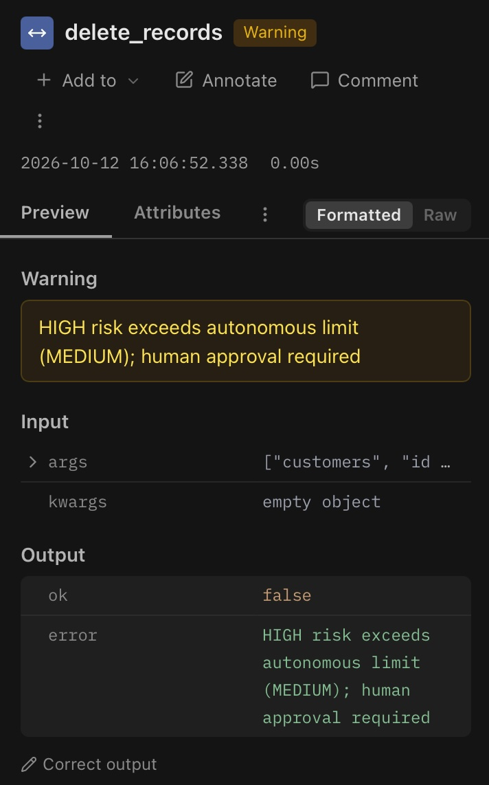

# Governed Database Assistant

An LLM agent with database access, wrapped in the governance controls that agent systems need before they can be trusted: tiered permissions, human approval for destructive actions, and a full audit trail.

The agent itself is deliberately simple. The governance layer around it is the point of the project.

## Why this exists

Giving an agent database access is easy. Giving it access safely is the hard part. This project explores a practical pattern:

- Classify every tool by **risk level** (read, transform, destroy)
- Enforce limits **in code**, not in a prompt the model could ignore
- Require **human approval** before anything irreversible runs
- Record **every attempt**, allowed or denied, in an audit trail

## Status

| Component | Status |
|---|---|
| SQLite database with related tables | Done |
| `query_data` tool (read-only, two-layer enforcement) | Done |
| Permission decorator with risk tiers | Done |
| JSONL audit log | Done |
| Langfuse tracing of tool calls (allowed and denied) | Done |
| LangGraph agent | Planned |
| Langfuse tracing of LLM calls (model, tokens, tool choices) | Planned, needs the agent |
| Human-in-the-loop approval gate | Planned |
| Dry-run preview for destructive actions | Planned |
| FastAPI wrapper, Docker, CI/CD | Planned (stretch) |

## How it works

### Risk tiers

| Tier | Meaning | Example tool | Autonomy |
|---|---|---|---|
| LOW | Read-only | `query_data` | Runs without approval |
| MEDIUM | Transforms data, reversible | *(planned)* dbt run | Runs without approval |
| HIGH | Destructive, irreversible | `delete_records` | Denied; will require human approval |

A single setting, `MAX_AUTONOMOUS_RISK`, controls the highest tier the agent may run on its own. Anything above it is refused.

### Two layers of enforcement

Safety does not depend on any single check. For example, `query_data` is protected twice:

1. **Application layer:** the function accepts only a single `SELECT` statement.
2. **Database layer:** the connection is opened read-only, so SQLite itself refuses writes even if the first check were bypassed.

The schema adds a third layer: foreign keys are enforced (`PRAGMA foreign_keys = ON`), so a delete that would orphan rows fails at the database level too.

### Audit log

Every tool call attempt is appended to `audit_log.jsonl`, including denied ones. Each entry records the timestamp, tool, risk tier, arguments, decision, and outcome.

```json
{"timestamp": "2026-10-12T14:03:11", "tool": "delete_records", "risk": "HIGH", "decision": "denied", "reason": "HIGH risk exceeds autonomous limit (MEDIUM); human approval required"}
```

Note the distinction between `decision` and `outcome`: the permission layer decides whether a tool may run at all, while the tool's own validation decides what it will do once running. A call can be `allowed` by the first and still end in an `error` from the second.

### Tracing with Langfuse

The permission decorator also wraps every tool call in a [Langfuse](https://langfuse.com) span, so the audit trail is browsable as well as logged to a file:

- Each tool call appears as its own span, named after the tool and nested under the parent trace
- Allowed calls are tagged with their risk tier and `decision: allowed`
- Denied calls are flagged at WARNING level, with the denial reason as the status message
- Calls that were allowed but failed inside the tool (for example, a rejected SELECT) are flagged at ERROR level

`audit_log.jsonl` is the raw local record; Langfuse is the reviewable one. Once the LangGraph agent is in place, the same traces will also capture the model used, token counts, and the LLM's tool choices alongside these permission decisions.

<p align="center">
  <br>
  <em>A denied <code>delete_records</code> call, flagged at WARNING level with the reason it was refused.</em>
</p>

*A denied `delete_records` call, flagged at WARNING level with the reason it was refused.*

## Database schema

Three related tables with foreign keys, enough structure for meaningful joins and meaningful cascade risk:

- `customers` (id, name, segment, created_at)
- `accounts` (id, customer_id, account_type, balance)
- `transactions` (id, account_id, amount, date, flagged)

All data is synthetic.

## Setup

```bash
python3 -m venv venv && source venv/bin/activate
pip install langgraph langchain-anthropic langfuse python-dotenv
python setup_db.py        # creates governed_agent.db with sample data
python tools.py           # runs manual checks against the tools
cat audit_log.jsonl       # inspect the audit trail
```

To enable tracing, create a free project at langfuse.com, then add your keys to a `.env` file in the project root:

```
LANGFUSE_PUBLIC_KEY=pk-lf-...
LANGFUSE_SECRET_KEY=sk-lf-...
LANGFUSE_HOST=https://cloud.langfuse.com   # use https://us.cloud.langfuse.com for the US region
```

`.env` is listed in `.gitignore` and should never be committed. Then verify the connection:

```bash
python langfuse_check.py  # sends a test trace; check the Tracing page in Langfuse
```

## Project structure

```
setup_db.py         # creates the SQLite database and sample data
tools.py            # agent tools (query_data, delete_records placeholder)
permissions.py      # risk tiers, permission decorator, audit logging, Langfuse spans
langfuse_check.py   # smoke test for Langfuse credentials and tracing
.env                # local credentials (not committed)
```

## Known limitations

- **The audit log and Langfuse traces store raw queries; production use would require redaction and access controls.** Queries can contain sensitive values (identifiers, personal data), and recording them verbatim copies that data into additional, less protected locations: a local file and a third-party observability service. Here the data is synthetic, so this is acceptable for a demo, but a real deployment would mask literals before logging, restrict access to both stores, and define retention rules.
- `delete_records` is currently a placeholder that is always denied. The real implementation, with a dry-run preview and approval gate, is planned.
- SELECT validation is a simple prefix check backed by a read-only connection. It is not a full SQL parser, which is why the database-level layer matters.
- The autonomy policy is a single global setting. A real system would scope permissions per user, per agent, and per environment.
- Only tool calls are traced so far. LLM-level tracing arrives with the agent.

## Roadmap

1. Wrap the tools in a LangGraph agent so an LLM chooses which to call
2. Extend Langfuse tracing to the LLM calls (model, tokens, tool choices)
3. Add the human-in-the-loop approval gate for HIGH-risk tools
4. Add a dry-run preview showing affected rows and cascade impact before approval
5. Optional: FastAPI wrapper, Docker, GitHub Actions deployment
